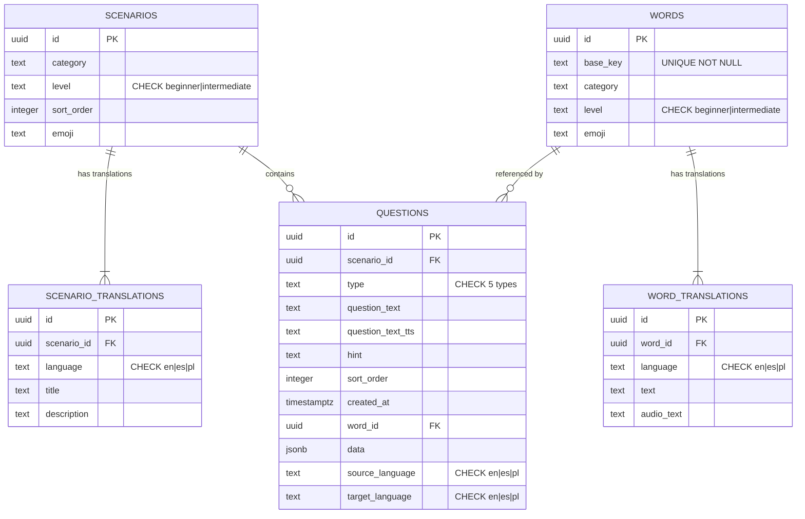

# PalabraBox Database (Supabase)

Reference documentation for the PalabraBox database: schema, security, indexes,
migration workflow, content workflow, and the production verification record.

**Current state (2026-10-10, end of phase 2 in [PLAN.md](PLAN.md)):** the schema is
defined by a single baseline migration plus incremental migrations; content is
generated from `scripts/content_blocks/`; the data layer reads only the
normalized schema. A legacy-column cleanup migration is ready to push after the
E7 deploy (see the deployment choreography below).

---

## Production verification — 2026-10-10 (E0)

Verified against full dumps of the production database taken before the migration baseline (reference snapshots in `supabase/archive/`):

- `prod_schema_20261008.sql` — full schema dump
- `backup_data_20261008.sql` — data-only dump, kept as the **pre-wipe content backup**

**Live verification (2026-10-10).** The read-only report from `scripts/db/verify.sql` (archived as `supabase/archive/verify_report_20261008.csv`) confirms the dump analysis against the live database — identical counters, drift and quality numbers. It adds two facts the dumps could not show:

- **Migration history:** production records 11 versions — the 10 historical migrations **plus `20261007203525_remote_schema`**. The drift diff was pushed as a migration on 2026-10-07, which is exactly how the vestige columns landed in production.
- `supabase_migrations.schema_migrations` has columns `version`, `name`, `statements` (no `inserted_at` on this project).

### Schema: migrations + known drift

Production matches what the historical migrations produce, plus drift left over from keeping the live app working:

| Drift                                                                                                                   | Detail                                                                                                                                                                      |
| :---------------------------------------------------------------------------------------------------------------------- | :-------------------------------------------------------------------------------------------------------------------------------------------------------------------------- |
| `questions.correct_answer`, `questions.wrong_answers`, `questions.image_emoji`                                          | legacy columns re-added outside migrations (87 old-seed rows still use them)                                                                                                |
| `words.word`, `words.language`, `words.translation_es`, `words.translation_en`, `words.image_emoji`, `words.audio_text` | same — 96 old-seed words live only in these columns                                                                                                                         |
| `words.base_key` nullable                                                                                               | migrations declare `NOT NULL`                                                                                                                                               |
| constraint names                                                                                                        | `scenarios_new_pkey`, `words_new_pkey`, `scenarios_new_level_check`, `words_new_level_check`, `words_new_base_key_key` leak the table rename inside the 2026-03-27 refactor |

Removal plan: the vestige columns are dropped **only after E7 is deployed** (the live app still reads them) by a dedicated `drop_legacy_columns` migration, which also restores `NOT NULL` on `words.base_key`. Constraint renames happen in E3.

### Content inventory

| Table                   | Rows | Notes                                                                                                                                                                                                                                                                                        |
| :---------------------- | :--- | :------------------------------------------------------------------------------------------------------------------------------------------------------------------------------------------------------------------------------------------------------------------------------------------- |
| `scenarios`             | 36   | 30 from content blocks + 6 old-seed scenarios (colors/animals/food/family/body/travel), duplicated, without translations                                                                                                                                                                     |
| `scenario_translations` | 60   | 30 `en` + 30 `es` (block scenarios only)                                                                                                                                                                                                                                                     |
| `words`                 | 359  | 263 block words (`base_key`) + 96 old-seed words (vestige columns only, `base_key IS NULL`)                                                                                                                                                                                                  |
| `word_translations`     | 479  | 263 `en` + 216 `es`                                                                                                                                                                                                                                                                          |
| `questions`             | 783  | 360 with `question_text = 'undefined'` (generator bug, AUDIT §2.3.3); mixed direction (`source_language`: 366 `en` / 330 `es` / 87 NULL); 139 choice-type questions without usable `options` (85 `image_match` with empty `data`, 38 `listening`, 16 `multiple_choice`); old seed duplicated |

### Decision (owner, 2026-10-08)

Production content is not worth migrating. The E5 content migration wipes all content tables and loads normalized content (es→en) generated from `scripts/content_blocks/`. `backup_data_20261008.sql` is the pre-wipe backup.

---

## Schema

Five tables in the `public` schema. Language-independent entities (`scenarios`,
`words`) are separated from their per-language translations, and all
question-type-specific payload lives in one `jsonb` column.



### `scenarios`

Language-independent scenario (lesson) registry.

| Column       | Type      | Notes                                           |
| :----------- | :-------- | :---------------------------------------------- |
| `id`         | `uuid`    | PK, default `gen_random_uuid()`                 |
| `category`   | `text`    | topic category (e.g. `travel`, `daily_life`)    |
| `level`      | `text`    | `CHECK (level IN ('beginner', 'intermediate'))` |
| `sort_order` | `integer` | display order within a level                    |
| `emoji`      | `text`    | scenario icon (added in E3)                     |

### `scenario_translations`

UI-facing titles/descriptions per language.

| Column        | Type   | Notes                                         |
| :------------ | :----- | :-------------------------------------------- |
| `id`          | `uuid` | PK                                            |
| `scenario_id` | `uuid` | FK → `scenarios.id` `ON DELETE CASCADE`       |
| `language`    | `text` | `CHECK (language IN ('en', 'es', 'pl'))` (E3) |
| `title`       | `text` | translated title                              |
| `description` | `text` | translated description, nullable              |

Unique: `(scenario_id, language)`.

### `words`

Central vocabulary registry (flashcards).

| Column     | Type   | Notes                                                      |
| :--------- | :----- | :--------------------------------------------------------- |
| `id`       | `uuid` | PK                                                         |
| `base_key` | `text` | `UNIQUE NOT NULL` — natural key (e.g. `hello`)             |
| `category` | `text` | topic category                                             |
| `level`    | `text` | `CHECK (level IN ('beginner', 'intermediate'))`            |
| `emoji`    | `text` | flashcard icon (added in `20261010120000_add_words_emoji`) |

### `word_translations`

Per-language word text + TTS fragment.

| Column       | Type   | Notes                                         |
| :----------- | :----- | :-------------------------------------------- |
| `id`         | `uuid` | PK                                            |
| `word_id`    | `uuid` | FK → `words.id` `ON DELETE CASCADE`           |
| `language`   | `text` | `CHECK (language IN ('en', 'es', 'pl'))` (E3) |
| `text`       | `text` | the word in this language                     |
| `audio_text` | `text` | TTS fragment, nullable                        |

Unique: `(word_id, language)`.

### `questions`

Quiz questions inside scenarios. Type-specific payload in `data` jsonb.

| Column              | Type          | Notes                                                                                         |
| :------------------ | :------------ | :-------------------------------------------------------------------------------------------- |
| `id`                | `uuid`        | PK                                                                                            |
| `scenario_id`       | `uuid`        | FK → `scenarios.id` `ON DELETE CASCADE`                                                       |
| `type`              | `text`        | `CHECK (type IN ('multiple_choice', 'image_match', 'listening', 'fill_blank', 'word_order'))` |
| `question_text`     | `text`        | prompt in the UI language (Spanish); for `fill_blank` it contains the `___` blank marker      |
| `question_text_tts` | `text`        | audio for `listening`, assembled sentence for `word_order`                                    |
| `hint`              | `text`        | optional in-game hint                                                                         |
| `sort_order`        | `integer`     | question order inside a scenario                                                              |
| `created_at`        | `timestamptz` | default `now()`                                                                               |
| `word_id`           | `uuid`        | optional FK → `words.id` (word stats), nullable                                               |
| `data`              | `jsonb`       | type-specific payload (see below)                                                             |
| `source_language`   | `text`        | `CHECK (… IN ('en', 'es', 'pl'))` — always `es` (E3)                                          |
| `target_language`   | `text`        | `CHECK (… IN ('en', 'es', 'pl'))` — always `en` (E3)                                          |

#### The `data` jsonb contract (normalized, es→en)

Product direction: **a Spanish speaker learns English** — the prompt is Spanish,
the answer is English (except `listening`, where the audio is English and the
answer is the Spanish meaning).

| `type`            | `data` shape                                                                                                                                                                        |
| :---------------- | :---------------------------------------------------------------------------------------------------------------------------------------------------------------------------------- |
| `multiple_choice` | `{ "correct": "hello", "options": ["hello", "yes", …], "tts": [{"text": "hello", "lang": "en"}] }` — options are English, correct included                                          |
| `listening`       | `{ "correct": "hola", "options": ["hola", "adiós", …], "audio_text": "hello", "tts": [{"text": "hello", "lang": "en"}] }` — audio English, options Spanish                          |
| `fill_blank`      | `{ "correct": "water", "options": ["water", "milk", …], "tts": […] }` — `question_text` is the Spanish sentence with `___`                                                          |
| `word_order`      | `{ "correct": ["I", "drink", "water."], "words": ["I", "drink", "water.", "milk", …], "tts": [{"text": "I drink water.", "lang": "en"}] }` — `words` = correct tokens + distractors |
| `image_match`     | `{ "correct": "cat", "options": ["cat", "dog", …], "image_emoji": "🐱", "tts": […] }` — English words, emoji prompt                                                                 |

Every question also carries `source_language = 'es'` and `target_language = 'en'`.
The structured `tts` array (`[{text, lang}]`) is the input for the TTS phase (F3);
`question_text_tts` is the legacy column the current components read.

### Indexes

| Index                             | Table.columns                          | Purpose                           |
| :-------------------------------- | :------------------------------------- | :-------------------------------- |
| `idx_questions_scenario`          | `questions(scenario_id)`               | questions per scenario (baseline) |
| `idx_word_translations_word_lang` | `word_translations(word_id, language)` | translation lookup (baseline)     |
| `idx_scenarios_level_sort`        | `scenarios(level, sort_order)`         | scenario list per level (E3)      |
| `idx_questions_word_id`           | `questions(word_id)`                   | word stats join (E3)              |

The remaining FK columns are covered by the composite unique indexes:
`scenario_translations(scenario_id, language)` and `word_translations(word_id, language)`.

### Row Level Security

All five tables have RLS enabled with a single public-read policy each (the MVP
has no player auth yet; writes stay restricted to `service_role` — dashboard and
migrations):

- `Allow public read - scenarios`
- `Allow public read - scenario_translations`
- `Allow public read - words`
- `Allow public read - word_translations`
- `Allow public read - questions`

---

## Migration workflow (E2)

The 10 historical migrations (2026-03-18 … 2026-03-30) are squashed into a single baseline: `supabase/migrations/20260318000000_baseline.sql`. The version deliberately keeps the earliest historical timestamp so the production migration history already records it.

**Local:** `npx supabase db reset` rebuilds the full database (schema + content) from `supabase/migrations/` alone; `seed.sql` is a documented no-op (E8).

**Production (one-time, owner action).** The migration history is known (see above): 11 recorded versions, of which the baseline keeps `20260318000000`. Run:

```bash
# 1. mark the 10 superseded versions as reverted (20260318000000 stays applied)
npx supabase migration repair --status reverted 20260324000000 20260327100000 20260327110000 20260327120000 20260327130000 20260327140000 20260327150000 20260327160000 20260330173417 20261007203525

# 2. push — expected to apply ONLY the new E3 migration, nothing else
npx supabase db push

# 3. confirm the clean state: baseline + E3 applied, nothing pending
npx supabase migration list
```

After the repair, `npx supabase db pull` should report **only the known drift** (vestige columns, `base_key` nullability, constraint names) — if it reports anything else, stop and investigate. The generated diff file is expected; review it and delete it, do not commit (only `supabase/migrations/` is applied by the CLI).

Migration naming convention: `YYYYMMDDHHMMSS_snake_case.sql` (see
[CONTRIBUTING.md](../CONTRIBUTING.md)). Never commit `db pull` output to
`supabase/migrations/` — it breaks the shadow database; archive it in
`supabase/archive/` instead.

---

## Content workflow (E4/E5)

Content lives in `scripts/content_blocks/*.json` — normalized to the product direction **es→en** (prompt in Spanish, answer in English). Never hand-edit the generated migration.

1. Edit a block (or add a new `*.json`). The shape is validated by `scripts/content-schema.mjs` (zod).
2. `npm run content:check` — schema + semantic checks: options completeness, learning direction, blank markers, `base_key` conflicts, tts sanity. Must pass with 0 errors.
3. Regenerate the migration: `node scripts/generate-sql.mjs --wipe supabase/migrations/<timestamp>_content.sql` (use `--wipe` for full rebuilds).
4. Commit the generated migration and push it with `npx supabase db push`. A full rebuild (wipe) is pushed **after the E7 deploy** — the live app keeps reading the legacy columns until then.

Current content: 24 scenarios, 200 words, 388 questions (360 normalized + 28 generated `image_match`), delivered by `20261010130000_content_normalized.sql`.

`seed.sql` is an intentional no-op (`SELECT 'seed skipped'`) — content lives in versioned migrations, so `supabase db reset` always rebuilds the full database (schema + content) from `supabase/migrations/` alone.

### Production deployment choreography (once, at the end of phase 2)

The live app still reads the legacy columns until the E7 build is deployed:

1. `npx supabase db push` — applies `20261010120000_add_words_emoji` + `20261010130000_content_normalized` (full content rebuild)
2. Deploy merged `main` (Vercel) — the app switches to the normalized schema
3. `npx supabase db push` — applies `20261011000000_drop_legacy_columns` (vestige columns + `base_key NOT NULL`)

---

## TypeScript types (E6)

Database types are generated, never hand-edited:

```bash
npm run db:types   # npx supabase gen types typescript --local | prettier > src/types/db.ts
```

Requires the local stack (`npx supabase start` / `npx supabase db reset`).
The app maps rows onto UI types in `src/types/index.ts` (hooks do the mapping);
`src/lib/supabase.ts` creates a typed client (`createClient<Database>`).

---

## Developer notes

- **Upserts:** words use `ON CONFLICT (base_key)`, translations use
  `ON CONFLICT (word_id, language)` / `ON CONFLICT (scenario_id, language)`,
  questions use `ON CONFLICT (id)` — the generator emits all of them.
- **Deterministic IDs:** the content generator derives UUIDs from stable seeds
  (md5), so regenerating unchanged blocks produces byte-identical SQL.
- **Language codes:** always `en` / `es` / `pl` (CHECK-constrained since E3).
- **Verification:** `scripts/db/verify.sql` is a read-only report for the live
  production database (counters, migration history, drift, duplicates, RLS) —
  run it in the Supabase SQL Editor and archive the result in `supabase/archive/`.
- **Backups:** `npx supabase db dump --linked -f <file>.sql` (schema) and
  `npx supabase db dump --linked --data-only -f <file>.sql` (data). Reference
  snapshots live in `supabase/archive/`; ad-hoc dumps in the repo root are
  git-ignored.
